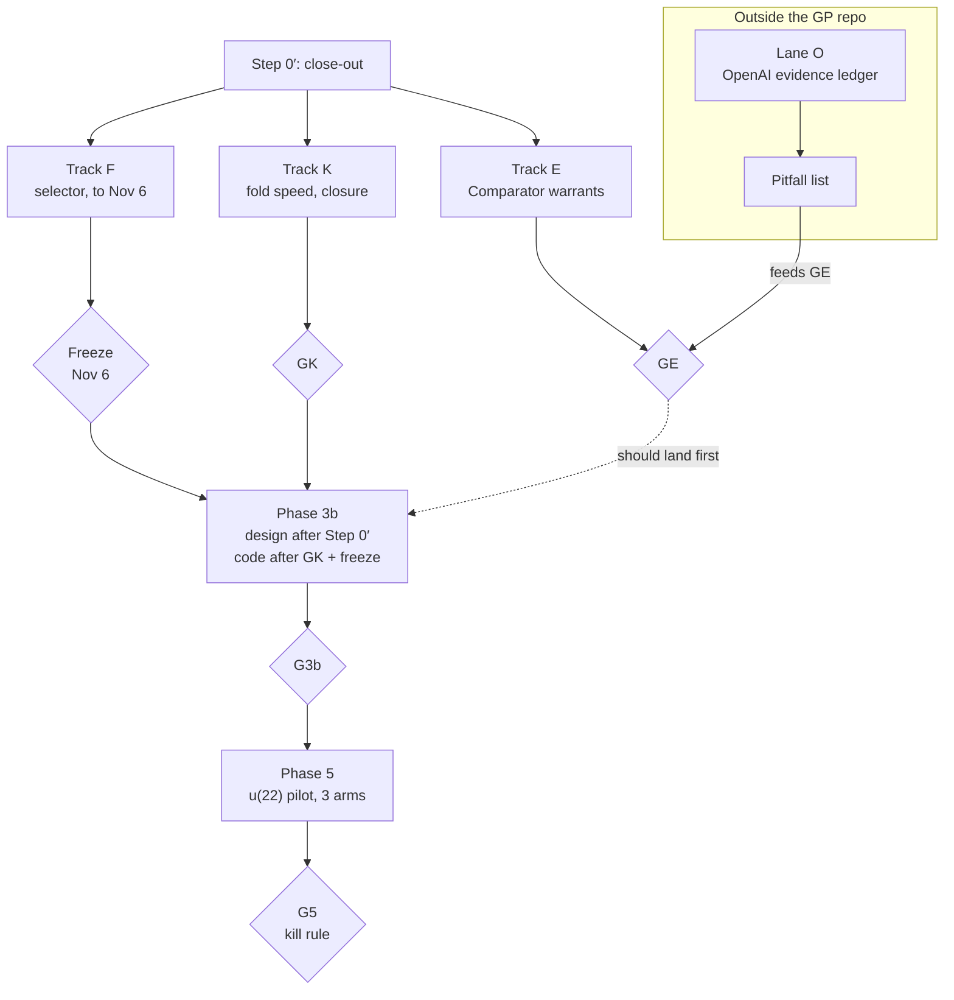

# GP 0.50 — post-G4 handoff: Comparator-shaped warrants, scale, and the road to u(22)

2026-10-06 · Will Strinz

## Summary

GP keeps its road to u(22). Before 3b, it makes its warrants checkable by stock Comparator and makes folds fast enough for a cold read at u(22) scale.

**Authority.** This handoff amends the [post-G3a handoff](GP-0.50-POST-G3A-HANDOFF.md), which amends the post-G2 handoff and Addendum A. Where they conflict, this one wins. It starts from workspace `master` at `3bd0bf0` (G4 closed).

**In plain language.**

- The pilot-first plan worked. 3P held χ for 493 matroids with no false ACCEPT, G3P passed its cold read, and G4 closed.
- The pilot's biggest finding was scale, not correctness. `gp status` takes 228 s at 1,891 claims, and the Kernel `closure` is cubic.
- OpenAI's mathematics release (722 manuscripts, 405 Comparator challenges) makes Lean statement plus Comparator the standard contract. Its bottleneck is statement fidelity, not proof checking. Long certified search campaigns are untouched.
- The release corpus fails GP's own selection filter (decision 8): Comparator is a cheap authoritative verifier for the formalized half, and GP has no checker for the rest. Its evidence ledger is worth building, outside GP.
- So GP adopts Comparator's format for its warrants, fixes fold cost, leaves the foreign-incident window open to catch errata from the release, and then proceeds 3b → G3b → Phase 5 on u(22) as planned.

**Status of these decisions.** Will accepted them provisionally on 2026-10-06. The builder records them in `DECISIONS.md` as provisional. Will confirms or revises each before the first gate that depends on it (§1 says which).

## 1. Decisions (provisional, Will, 2026-10-06)

Nine decisions. Copy this section into `DECISIONS.md` verbatim, marked provisional. Each names the point by which Will confirms or revises it.

1. **The OpenAI corpus is not a GP campaign.** It fails decision 8 on (i): Comparator verifies the formalized families, and GP has no checker for the rest, so every GP claim would land OPEN. Its evidence ledger runs as Lane O (§9), outside the GP repo and timeboxed. GP gains no profile, statement kind or surface for it. *Confirm by:* the start of Lane O.
2. **Comparator-shaped warrants.** Decision 9's emitter emits, for each held claim within coverage, a Comparator challenge (statement only, Mathlib imports, standard axioms) and a solution. Tailings are then checkable by stock `comparator` with no GP installed. *Confirm by:* gate GE (§4).
3. **Map-rule warrants unpaused**, under Track E. This is emitter work, not a profile extension. The algebraic and census profiles otherwise stay frozen. *Confirm by:* the start of Track E.
4. **Kernel `closure` rewrite approved**, before any 3b code. It is the one Kernel change in this handoff. It must keep every Kernel theorem and leave fold output byte-identical on the 3P ledger, the DK slice and the corpus. *Confirm by:* the re-pin, which is a stop-and-ask (§10).
5. **A fold performance budget becomes a G5 precondition** (§5). The numbers are provisional and Will may revise them at GK. *Confirm by:* gate GK.
6. **The foreign-incident window stays open until 2026-11-06**, so confirmed errata from the OpenAI release can be candidates. 3b design work may proceed before the freeze; 3b code waits for it. Will may close the window early if it blocks code. *Confirm by:* the freeze.
7. **The 3b → G3b → Phase 5 (u(22)) sequence is unchanged.** u(22) is untouched by the release and passes all three parts of decision 8. *Confirm by:* G3b.
8. **Custody share is stated in every phase report**, including retroactive lines for the Phase 4 and F2 reports (§3). *Confirm by:* Step 0′.
9. **Any public push of Comparator-checkable tailings is Will's call.** It goes beyond the approved alpha. *Confirm by:* before the push.

## 2. Sequence

Tracks K, E and F run in parallel after Step 0′. 3b code waits for GK and the freeze, ideally after GE too. Lane O runs outside the repo; its errata reach Track F only once publicly confirmed.

## 3. Step 0′: G4 close-out

Step 0′ is small and finishes before Tracks E and K start.

- [ ] **Decisions.** Copy §1 into `DECISIONS.md`, marked provisional, and update `STATUS.md` in the same commit.
- [ ] **n = 23 differential.** Record the full run (about 32,000 checks) in `reports/DK-V4-RECEIPT.json` and the Phase 4 report. Any mismatch is a stop-and-ask.
- [ ] **Custody share, retroactively.** Add the line to `reports/PHASE-4-REPORT.md` and `campaigns/3p-matroids/F2-REPORT.md` (the builder appends to F2 under a builder note; it never edits campaign text). A count from `3bd0bf0` gives 6 of 27 non-merge commits since 2026-10-04 as custody-only, about 22%, under the 30% tripwire; the builder re-derives it with its own rule.
- [ ] **F2 catalog counts.** The counts 1, 2, 4, 9, 23, 68 and 383 for n = 3…9 match Table 2 (rank 3) of [Mayhew–Royle, *Matroids with nine elements*](https://arxiv.org/abs/math/0702316). Hand the citation to the campaign agent, which re-cites and drops `[VERIFY]` from the counts. The F1 Oxley section citations stay `[VERIFY]`.
- [ ] **3P → 3b findings note.** The one-page note that post-G3a §6 requires before any 3b code: surfaces, refusal messages, warrant emission, statement ergonomics, and now fold cost.

## 4. Track E: Comparator-shaped warrants

Track E makes every warrant GP emits a challenge that stock `comparator` can check, and closes the 3P coverage gap from 31% toward full.

**Why.** The release made a Lean challenge plus Comparator the contract outsiders already know how to trust. A GP tailing in that shape needs no GP to check, which is decision 9's durable form stated in the experts' format.

**Deliverables.**

1. **Emitter output format.** For each held claim within coverage: a challenge module holding only the statement, with Mathlib imports, and a solution module that proves it. Use the challenge/solution/config layout `leanprover/comparator` documents at a pinned commit; the builder reads its current README rather than this handoff for the details.
2. **Short, Mathlib-vocabulary statements.** The challenge states the claim's meaning ("M is realizable over every field of characteristic p for p ∉ S"), not GP's encoding. The framed system and `frame_iff` live in the solution. Where Mathlib has the concept at the pin, use it. Where it does not, define it in the challenge in as few lines as possible. Target: at most 40 lines per challenge beyond the matroid's data.
3. **Map-rule warrants (1,241 claims).** Transport a held point along a field map, with the guard obligations discharged in the solution.
4. **Mod-p certificates (43 claims).** Emptiness over the algebraic closure of F_p from an ideal certificate, on standard axioms.
5. **CI job.** Run pinned `comparator` on every emitted 3P challenge. It needs Linux with Landlock and a non-root user (`landrun`), so check the runner supports both before writing the job.

**The census caveat.** Comparator permits standard axioms only. Census warrants that rest on native LRAT replay carry admitted native trust (`TCB.md`), so they are outside Comparator's scope. Report them as a separate class with that reason. Do not widen the permitted axioms to make them pass.

**Gate GE.**

- Stock `comparator` passes on every emitted 3P challenge in CI.
- Lean-warrant coverage on the 3P ledger is at least 95%, every remaining gap listed with its reason.
- An agent that is not the builder audits 20 randomly drawn challenge statements against their claims' meanings and finds zero fidelity defects. It uses Lane O's pitfall list (§9) once that exists.
- No Kernel change, and the 3P ledger replays unchanged.

**Stop and ask** if a challenge statement cannot be kept in Mathlib vocabulary without a definition over 40 lines, or if any warrant needs a non-standard axiom.

## 5. Track K: fold performance and the Kernel `closure` rewrite

Track K brings a cold read of a large ledger under a minute, because a slow `status` would fail G5's Elm test on ergonomics before it tests anything else.

**Where it stands at `3bd0bf0`.**

| Measure | 3P ledger (1,891 claims) |
| --- | --- |
| Builder's full fold | 216 s |
| `gp status` | 228 s |
| Kernel `closure` alone, at about 2,000 claims | about 75 s |
| Folds per `Plan.run` | 2 |

**Order of work.**

1. **Measure first.** Profile one fold and one `status` on the 3P ledger and report where the time goes before changing anything.
2. **Profile-level fixes**, no Kernel change: fold once per `Plan.run`, and stop `status` refolding work it can reuse.
3. **The `closure` rewrite** (decision 4): replace the cubic list operations with an indexed least-fixpoint computation, as G1 already framed earned closure. Prove the new closure extensionally equal to the old one, so every downstream Kernel theorem carries over unchanged. Then re-pin `KERNEL-PIN.json`, which is a stop-and-ask.
4. **Differential.** Fold output must be byte-identical on the 3P ledger, the DK slice and all 462 corpus cases.

**Gate GK, and the provisional budget** (decision 5).

- On the 3P ledger: a full fold in at most 30 s, and `gp status` in at most 20 s.
- On a synthetic 10,000-claim ledger shaped like 3P: a fold in at most 120 s and `status` in at most 60 s. The size of a u(22) ledger is unknown; 10,000 is a placeholder at about five times 3P.
- Measured at 1,000, 2,000, 5,000 and 10,000 claims, growth is no worse than about n log n.
- Every Kernel theorem holds on standard axioms, and each Kernel module passes `leanchecker`.

If profile-level fixes alone meet the budget, skip the rewrite and say so; decision 4 approves the rewrite, it does not require it.

## 6. Track F: the foreign-incident window

The six foreign incidents for G5 are selected over a window that closes 2026-11-06, then frozen and hashed before any 3b code.

**Unchanged from post-G3a §7.** Each incident needs a computational claim, replayable exact inputs, and an error confirmed in a primary source. A separate selector agent with no access to `INCIDENT-INVENTORY.md` picks them against those written criteria. Will approves the list.

**Amendments.**

- **Start the selector now** and keep a running candidate list with sources, so the freeze is a pick from a list, not a search.
- **Release errata qualify on the same criteria.** The likely kinds are a wrong computational result (the release's certified computations, such as MUB(6) or circulant Hadamard) or a Comparator challenge whose statement is shown not to mean what its paper claims.
- **Confirmed publicly, not by us.** An error found by Lane O or any of Will's agents counts only once OpenAI or an independent party confirms it in public. This keeps us from grading GP on incidents we manufactured.
- **At most two of the six from the release**, so one corpus does not dominate the set.
- **No access to GP's 3b work** for the selector, in either direction.

## 7. Phase 3b amendments

Phase 3b's design is as in post-G2 §5 and post-G3a §6. It opens later and ships its warrants in Comparator shape from the start.

- **Entry.** 3b *design* may start after Step 0′. 3b *code* waits for GK and the foreign-set freeze. GE should land first; if it slips, 3b code may start alongside it.
- **Every 3b checker ships with its emitter path**, or a written reason it cannot have one. No new checker is un-emittable by default.
- **Context truth before code** (unchanged). Settle the ordered-statement question with M1 first: quantify over orderings, or an ordered-field profile.
- **What u(22) needs from 3b**, from the Lane K plan:
    - complex-realizability claims, held as a relaxation of real realizability;
    - a refusing control showing that a ℂ claim never transports to ℝ;
    - a checker path for square-class independence (the Kummer split), or that independence held as a visible OPEN premise.
- **G3b** is otherwise unchanged: the Cloquet and u(22) realization moves need an admitted checker path.

## 8. Phase 5 and G5 amendments

Phase 5 stays the u(22) pilot with the kill rule. Three amendments sharpen what G5 measures.

- **Arm (b) becomes Lean plus Comparator.** Rev 3's Lean-plus-blueprint arm writes each claim as a Comparator challenge and checks it with stock `comparator`, the workflow the release made standard. GP must then be not dominated by (b) on errors and beat it on workability, as rev 3 already requires.
- **Performance at the cold read.** Re-measure the GK budget on the u(22) ledger before Will's cold read. If `gp status` exceeds 60 s there, report it prominently even if the Elm test passes.
- **Comparator coverage is a G5 metric.** Report the share of held u(22) claims whose warrants pass stock `comparator`, with census claims on native LRAT trust as their own line.

The kill rule is unchanged: if the core does not beat the notebook arm, stop and reconsider; do not add features to rescue it.

## 9. Lane O: the OpenAI evidence ledger (outside GP)

Lane O builds an evidence ledger over [openai/math](https://github.com/openai/math) in its own repo, run by an agent that is not the GP builder, timeboxed to two sessions.

**Why outside GP.** It uses GP's concepts (claim, scope, warrant, premise propagation), not GP's checkers. Inside GP it would only show that a trivial profile type-checks, which nobody doubts.

**Starting point.** The 2026-10-06 analysis built a citation graph (579 internal edges, 138 across families), intro-versus-body edge labels, import cones for all 405 challenges, and size tiers. That sandbox may not have survived, so rebuild from scripts and re-check the counts.

**Deliverables, in order.**

1. **Theorem-level edge labels** on the 171 unformalized-to-unformalized edges flagged load-bearing: main input, corollary input or context, each with the citing sentence quoted. The Milne ↔ Hodge-for-CM cycle shows the intro/body heuristic over-flags, so 171 is an upper bound.
2. **A verification frontier for each headline result.** For example, H10 over ℚ rests in its proof body on Fontaine–Mazur at 2 (family 010) and on Goldfeld plus the 2-converse (006), both unformalized.
3. **Fidelity tiers for the 405 challenges:** the 9 pure-Mathlib statements, the short bespoke statements checked against the pitfall list, and the 45 over 200 lines flagged as too large to audit by hand.
4. **The pitfall list**, the reusable output: junk values (`sSup` of an unbounded set in ℕ is 0, division by zero), ℕ subtraction, vacuous hypotheses, degenerate witnesses, and whatever the audit adds. It feeds gate GE's statement audit and GP's meaning layer.
5. **Per-family JSON** with one warrant tier per result: Comparator-verified; verified but statement fidelity unaudited; prose only; prose resting on unverified prose.

**Not in Lane O.**

- A full Comparator sweep. Run one only if no community sweep has appeared, and only on a Linux VM with a non-root user.
- Publication or outside contact. Both stay Will's (A8).

**Stop** if a community ledger with a fidelity audit appears that covers this; link it and close the lane.

## 10. Process

Post-G3a §8 carries over, including the custody budget and its 30% tripwire, with these additions.

**Custody and words.**

- Every report states its custody share (decision 8), with the rule used to count it.
- Tracks E and K each target 3,000 new words of reports and docs, with a tripwire at 4,500.

**Stop and ask Will if:**

- the Kernel is about to be re-pinned (Track K);
- the n = 23 differential shows any mismatch;
- a warrant needs a non-standard axiom, or someone proposes widening Comparator's permitted axioms;
- a challenge statement cannot stay in Mathlib vocabulary within 40 lines of definitions;
- a 3b need requires a Kernel change or a new statement kind beyond post-G2 §5;
- any public push is needed, including Comparator-checkable tailings (decision 9).

**Not-list additions.** GP 0.50 will not:

- add a profile, statement kind or surface for the OpenAI corpus;
- let Lane O write to the GP workspace;
- count an error as a foreign incident before public confirmation;
- add MCP or hook surfaces before G5 (unchanged);
- let the builder author or edit campaign claims (unchanged).
